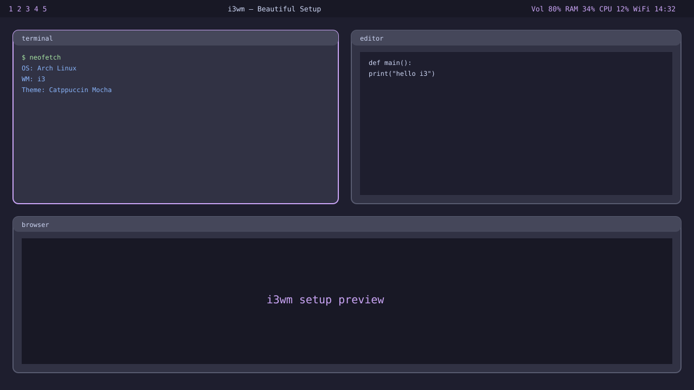

# i3wm — Beautiful Setup

A curated, modern i3wm desktop configuration.

**Theme:** Catppuccin Mocha · rounded corners · blur · gaps

## Includes

- `i3` window manager config
- `polybar` status bar
- `picom` compositor (blur, shadows, rounded corners)
- `rofi` app launcher
- `dunst` notifications
- `.Xresources` color scheme

## Install

```bash
git clone https://github.com/code-smith404/i3wm.git
cd i3wm
./install.sh
```

## Dependencies

i3, polybar, picom, rofi, dunst, feh, alacritty, JetBrainsMono Nerd Font, Papirus icons.

## Keybindings

- `Mod+Return` — terminal
- `Mod+d` — app launcher
- `Mod+Shift+q` — kill window
- `Mod+1..0` — workspaces
- `Mod+f` — fullscreen
- `Mod+r` — resize mode
- `Mod+Shift+e` — exit



See [preview.md](preview.md) for details.